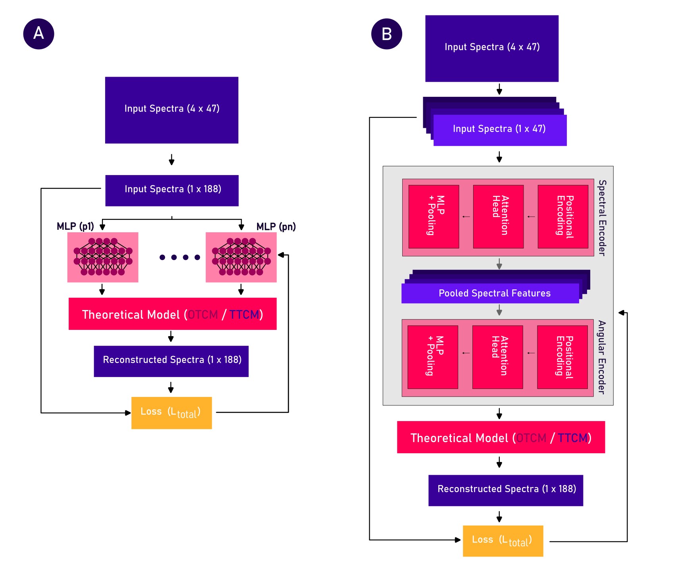
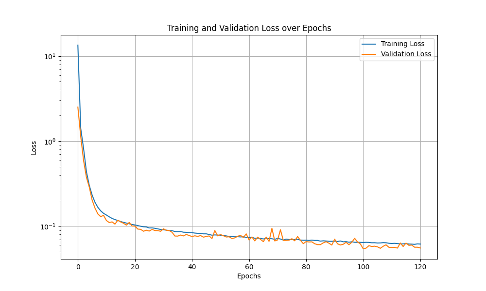
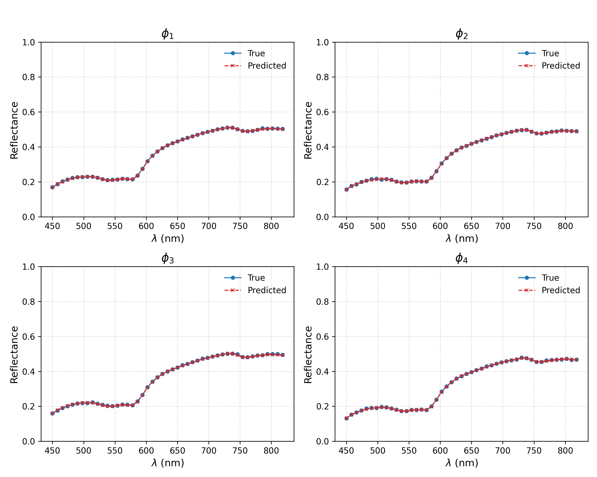
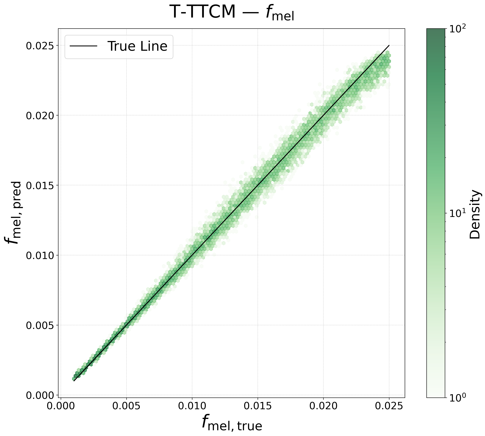
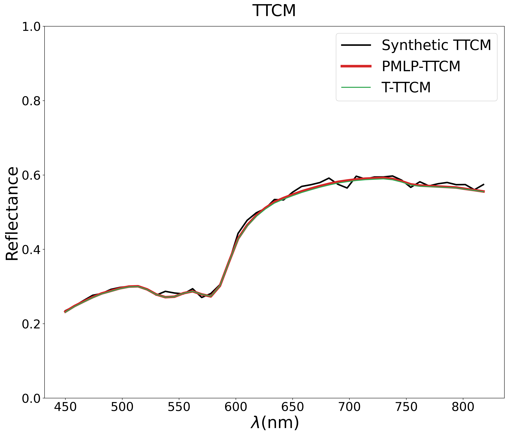
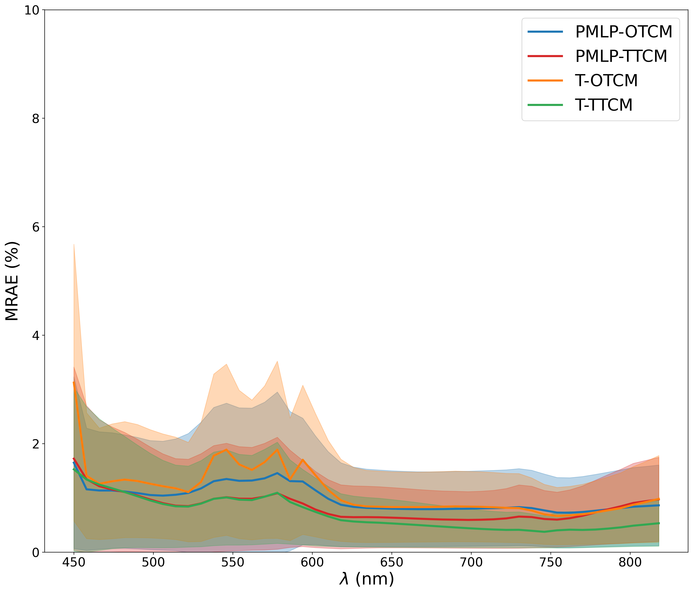

# PINNs-for-HSI-Optical-Property-Estimation

Physics-Informed Neural Networks (PINNs) for estimating physiological skin tissue parameters from hyperspectral reflectance spectra using the OTCM and TTCM skin models.

---

# Overview

This repository contains implementations of Physics-Informed Neural Networks (PINNs) designed to estimate physiological skin parameters from hyperspectral reflectance spectra generated using analytical skin models.

The repository implements two neural network architectures:

- **PMLP** (Physics-Informed Multi-Layer Perceptron)
- **Transformer-based PINN**

The implemented models are:

| Model | Description |
|---------|------------|
| PMLP-OTCM | Physics-informed multilayer perceptron using the One-Tissue Compartment Model (OTCM). |
| T-OTCM | Transformer-based implementation of OTCM. |
| PMLP-TTCM | Physics-informed multilayer perceptron using the Two-Tissue Compartment Model (TTCM). |
| T-TTCM | Transformer-based implementation of TTCM. |

---

# Optical Parameters

| Symbol | Description |
|---------|------------|
| BvF | Blood volume fraction |
| Hb_sat | Hemoglobin oxygen saturation |
| Rv | Mean vessel radius |
| MvF | Melanin volume fraction |
| d1 | Epidermal thickness |
| a1, a2 | Scattering amplitudes |
| b1, b2 | Scattering powers |
| e1-e4 | Surface reflectance coefficients |

---

# Architecture

The repository implements two neural network architectures:

- **PMLP** (Physics-Informed Multi-Layer Perceptron)
- **Transformer-based PINN**



*Figure 1. Overview of the implemented neural network architectures. (A) Physics-Informed Multi-Layer Perceptron (PMLP). (B) Transformer-based architecture. Both architectures predict physiological skin parameters that are subsequently passed through the analytical skin model (OTCM or TTCM) to reconstruct the input spectra.*

---

# Repository Structure

## Directories

| Directory | Description |
|------------|------------|
| Absorptioncoefficients | Contains absorption coefficients for melanin, oxygenated hemoglobin, deoxygenated hemoglobin, and refractive indices used by the skin models. |
| Evaluation | Contains evaluation results and synthetic test datasets. |
| Noise std | Contains estimated wavelength-dependent noise standard deviations. |
| PINN | Contains model-specific datasets, trained models, synthesized spectra, and results. |

### Absorption-coefficients

This `.npy` file contains a matrix with the absorption coefficients of the chromophores and the refractive indices of skin and air. The rows correspond to the chromophores/refractive indices, while the columns correspond to the 47 wavelength values ranging from 450 nm to 818 nm in steps of 8 nm.

| Python row index | Parameter                  | Source                           |
| ---------------- | -------------------------- | -------------------------------- |
| 0                | $\mu_{a,\mathrm{bg}}$      | Saidi et al. (1992) [1]          |
| 1                | $\mu_{a,\mathrm{HbO_2}}$   | Gratzer and Kollias (1998) [2]   |
| 2                | $\mu_{a,\mathrm{Hb}}$      | Gratzer and Kollias (1998) [2]   |
| 3                | $\mu_{a,\mathrm{water}}$   | Buiteveld et al. (1994) [3]      |
| 4                | $\mu_{a,\mathrm{fat}}$     | van Veen et al. (2005) [4]       |
| 5                | $\mu_{a,\mathrm{melanin}}$ | Jacques and McAuliffe (1991) [5] |
| 6                | $n_{\mathrm{skin}}$        | Ding et al. (2006) [6]           |
| 7                | $n_{\mathrm{air}}$         | Voronin and Zheltikov (2017) [7] |


In this work, the background absorption coefficient is modeled as $\mu_{a,\mathrm{bg}}$. The file additionally contains absorption coefficients for several chromophores, including water and fat. Additional chromophores may be incorporated in future extensions of the model.

### Noise standard deviation

This `.npy` file contains a vector of length 47 corresponding to the wavelength-dependent standard deviation of the measurement noise for each wavelength between 450 nm and 818 nm.

---

## Main Python Files

| File | Description |
|------|-------------|
| `main.py` | Main controlling functionality for training and evaluation workflows. |
| `arg_parse.py` | Defines command-line arguments and model hyperparameters. |
| `dataloader.py` | Generates synthetic datasets and loads training, validation, and test data. |
| `grid_search.py` | Performs hyperparameter grid search. |
| `final_model.py` | Trains the neural network models. |
| `analysis.py` | Evaluates model performance on synthetic, Monte Carlo, and in-vivo data. |
| `PINN.py` | Contains the neural network architectures. |

---

# Usage

## Step 1: Clone the Repository

```bash
git clone https://github.com/<username>/PINNs-for-HSI.git
cd PINNs-for-HSI
```

## Step 2: Install Dependencies

Install all required Python packages:

```bash
pip install -r requirements.txt
```

## Step 3: Grid Search, Final Model Training, and Analysis

The repository contains three main workflows:

* Grid search
* Final model training
* Model evaluation and analysis

All workflows are controlled through `main.py`.

The selected workflow (`grid_search`, `final_model`, or `analysis`) is configured in `arg_parse.py`.

---

# Grid Search

The following steps describe the grid search workflow.

## Step 1: Select the Mode

In `arg_parse.py`, select:

```python
mode = "grid_search"
```

## Step 2: Select the Model

Choose one of the following models:

* `PMLP_OTCM`
* `PMLP_TTCM`
* `T_OTCM`
* `T_TTCM`

Example:

```python
model = "PMLP_OTCM"
```

## Step 3: Select the Grid Search Slice

For PMLP models:

* `model_architecture`
* `learning_parameters`
* `regularization`

For Transformer models:

* `SET_architecture`
* `AET_architecture`
* `learning_parameters`

See Appelman et al. (2026) for details regarding the different optimization stages.

Example:

```python
grid_search_type = "model_architecture"
```

## Step 4: Define Initialization and Optical Parameter Ranges

Configure initialization settings, optical parameter ranges, and dataset settings in `arg_parse.py`.

Examples include:

* `BvF_min`
* `BvF_max`
* `MvF_min`
* `MvF_max`
* `batch_size`
* `epochs`

## Step 5: Run the Workflow

```bash
python main.py
```

## Grid Search Outputs

After completion, all checkpoints, generated plots, and Excel files are stored in:

```text
PINN/<model>/Results/Gridsearch/<date>/<slice>/
```

where:

* `<model>` corresponds to the selected model
* `<date>` corresponds to the training date
* `<slice>` corresponds to the selected grid search slice

---

# Final Model Training

The following steps describe the final model training workflow.

It is recommended to first perform a grid search or use the hyperparameters reported in Appelman et al. (2026).

## Step 1: Select the Mode

In `arg_parse.py`, select:

```python
mode = "final_model"
```

## Step 2: Select the Model

Choose one of the following models:

* `PMLP_OTCM`
* `PMLP_TTCM`
* `T_OTCM`
* `T_TTCM`

## Step 3: Define Hyperparameters

Configure the following in `arg_parse.py`:

* model architecture
* learning parameters
* regularization weights
* batch size

Examples include:

```python
hidden_layer_size = 128
learning_rate = 0.0001
epochs = 10
```

## Step 4: Define Initialization and Optical Parameter Ranges

Configure all initialization settings and optical parameter ranges.

## Step 5: Run the Workflow

```bash
python main.py
```

# Final Model Outputs

After training, the following outputs are generated:

* A checkpoint of the trained model (`.pkl`)
* Training and validation loss curves
* Reconstructed spectra for a representative training sample (index 100)

## Model Checkpoints

The trained model checkpoints are stored in:

```text
PINN/<model>/Results/Final model/<date>/checkpoint final model/
```

## Loss Curve Example

The training results include the loss curves, which are stored in:

```text
PINN/<model>/Results/Final model/<date>/Plot results/
```



*Figure 2. Example loss curve obtained during model training.*

## Reconstructed Spectra Example

The reconstructed spectra for a representative training sample (index 100) are stored in:

```text
PINN/<model>/Results/Final model/<date>/Plot results/
```



*Figure 3. Example of reconstructed spectra generated by the trained model.*

---

# Evaluation

The following steps describe the evaluation workflow.

Note that trained final models are required before performing the evaluation.

## Step 1: Select the Mode

In `arg_parse.py`, select:

```python
mode = "analysis"
```

## Step 2: Select the Model Checkpoint Dates

Specify the dates of the trained models in `arg_parse.py`.

Example:

```python
date_PMLP_OTCM = "2026-05-16"
date_PMLP_TTCM = "2026-05-16"
date_T_OTCM = "2026-05-16"
date_T_TTCM = "2026-05-16"
```

## Step 3: Select the Analysis Type

Choose one of the following:

* `hexabin`
* `reconstruction`
* `mrae`
* `all`

Example:

```python
analysis_type = "hexabin"
```

## Step 4: Select the Analysis Parameter

For hexabin density plots, select one of the following parameters:

* `MvF`
* `BvF`
* `S`
* `Rv`
* `b2`
* `e1`
* `e2`
* `e3`
* `e4`

Example:

```python
analysis_parameter = "BvF"
```

## Step 5: Run the Workflow

```bash
python main.py
```

# Hexabin Density Plot

When running `hexabin`, the mean absolute error and standard deviation of the selected parameter are printed.

The generated plots are stored in:

```text
Evaluation/Synthetic/Plots/Hexabin/
```



*Figure 4. Example of a hexabin density plot.*

# Reconstruction

When running `reconstruction`, reconstructed spectra are generated and stored in:

```text
Evaluation/Synthetic/Plots/Reconstruction/
```



*Figure 5. Example of reconstructed spectra.*

# MRAE

When running `mrae`, Mean Relative Absolute Error (MRAE) plots are generated and stored in:

```text
Evaluation/Synthetic/Plots/MRAE/
```



*Figure 6. Example of MRAE plots.*

# In Vivo Data and Reference Method

The in vivo datasets and reference method used in this work are not publicly available.

For access requests or additional information, please contact the corresponding author.

# Citation

If you use this work, please cite:

```bibtex
@misc{appelman2026pinns,
  title={Physics-Informed Neural Networks for Hyperspectral Skin Tissue Parameter Estimation},
  author={Appelman, Jelmer and co-authors},
  year={2026},
  note={Manuscript under review}
}
```

# References

[1] I. S. Saidi, *Transcutaneous Optical Measurement of Hyperbilirubinemia in Neonates*, Rice University, 1992.

[2] W. Gratzer and N. Kollias, *Tabulated Molar Extinction Coefficient for Hemoglobin in Water*. Medical Research Council Laboratories, London. Data compiled by S. Prahl, 1998.

[3] H. Buiteveld, J. H. M. Hakvoort, and M. Donze, "Optical properties of pure water," in *Ocean Optics XII*, vol. 2258, pp. 174–183, SPIE, 1994.

[4] L. P. van Veen, H. J. C. M. Sterenborg, A. Pifferi, A. Torricelli, E. Chikoidze, and R. Cubeddu, "Determination of visible and near-infrared absorption coefficients of mammalian fat using time- and spatially resolved diffuse reflectance and transmission spectroscopy," *Journal of Biomedical Optics*, vol. 10, no. 5, 054004, 2005.

[5] S. L. Jacques and D. J. McAuliffe, "The melanosome: threshold temperature for explosive vaporization and internal absorption coefficient during pulsed laser irradiation," *Photochemistry and Photobiology*, vol. 53, pp. 769–775, 1991.

[6] H. Ding, J. Q. Lu, W. A. Wooden, P. J. Kragel, and X.-H. Hu, "Refractive indices of human skin tissues at eight wavelengths and estimated dispersion relations between 300 and 1600 nm," *Physics in Medicine & Biology*, vol. 51, no. 6, pp. 1479–1489, 2006.

[7] A. A. Voronin and A. M. Zheltikov, "The generalized Sellmeier equation for air," *Scientific Reports*, vol. 7, no. 1, pp. 1–11, 2017.
